# unscheduled

Triage for the CVEs the NVD no longer analyzes.

The text model is the CPU fallback the plan names, frozen bge-small embeddings with a logistic head
per task, because the Kaggle secrets are absent; ModernBERT waits for them. The model registry is
MLflow's SQLite store, written from the committed run records, because no Databricks workspace is
connected.

Phase 1 is complete and tagged v0.1.0. Phase 2 of 5, the models, is in progress: 14 of
18 checklist lines are done. Still missing:

- The predictions in the serving bundle and the API; /v1/predict live; Neon under its ceiling
- The console shows every prediction with its model, version and uncertainty; design gates green; the look reviewed by Ajay
- The live check awake and asleep; reset and rederive reproduced every CPU model number
- At least fifty conventional commits; the release record passing; v0.2.0 pushed by Ajay; BUILD_STATE.md written for Phase 3

## What it is

Since 15 April 2026 the NVD enriches three kinds of CVE first: those in the CISA KEV catalog, those
in software the federal government uses and those in critical software. Every other CVE is labeled
lowest priority, not scheduled for immediate enrichment. Since 11 September 2026 a maker of a
product sold in the EU must send an early warning within 24 hours of learning that a vulnerability
in it is actively exploited. unscheduled measures the gap between the two and finds it in a
company's SBOMs. Over five phases it fills in, ranks and routes the CVEs nobody scheduled, and a
person approves every plan.

## See it

- The site, with the console, the report and the docs: https://unscheduled-triage.vercel.app
- The API, no key needed: https://unscheduled-api.vercel.app. Every route is on the site at
  /docs/api and in openapi.json.
- The models, each value labeled as a prediction: report/models.md, with a card for each in
  report/models/, and the method in docs/models.md.
- The first finding: of the CVEs published from 2020 to 2024, 80.2% were analyzed by
  the NVD within 30 days; of those published since 15 April 2026, 41.4%
  (report/backlog.md, Q1).

<picture>
  <source media="(prefers-color-scheme: dark)" srcset="web/public/diagrams/architecture-dark.svg">
  
</picture>

The diagrams on the docs pages are drawn with archify from the sources in docs/diagrams.

## The skills, and where each one is

Only what is built is listed; docs/ROADMAP.md holds the plan for the rest.

| Skill | Where | What it shows |
|---|---|---|
| Python and the data stack | packages/sources, packages/lake | polars, DuckDB and pyarrow |
| SQL and analytics engineering | dbt/models, dbt/macros | staging, intermediate and marts, and the as-of macro |
| Data quality | dbt/tests | contracts on every mart and the named quarantine rules |
| Point in time correctness | packages/lake, tests/lake | the as-of engine, its parity test and the planted future fact |
| Statistics | packages/analysis | cluster bootstrap, Cohen and weighted kappa, Benjamini-Hochberg, the domain classifier |
| APIs | packages/api, openapi.json | FastAPI over Neon, typed problem documents, the committed schema |
| API integration | packages/sources | NVD, CVE List, KEV, EPSS, OSV, GitHub advisories, GLEIF and EDGAR |
| Supply chain security | packages/match, customer/sboms | the matcher in code, checked by osv-scanner, with Grype as the CPE contrast |
| Legacy code | customer/legacy, tests/characterization, packages/legacy_adapter | characterization tests first, then a strangler with a byte for byte contract |
| CLI | packages/cli | the same services as the API |
| Modular design and trade offs | packages, docs/adr | one package per concern and a record for every decision |
| Coding agents | AGENTS.md, CLAUDE.md, .claude/skills | one source of rules and four skills in the Agent Skills format |
| CI and DevOps | .github/workflows, Dockerfile.vercel | the gates, gitleaks, zizmor, actions pinned by commit, Vercel deploys |
| Frontend and design systems | web, web/styles/tokens.css, tools/hallmark | tokens first, shadcn/ui themed through them, the palette validator |
| Accessibility and performance | .github/workflows/web.yml | axe and Lighthouse in CI |
| Forward deployed discovery | report/discovery.md, config/criteria.yaml | the discovery memo and the criteria the customer signed |
| Communication | report/backlog.md | the backlog report and the pushback paragraph on every evidence page |
| Technical writing | docs, docs/diagrams, CHANGELOG.md | a quickstart, the API reference from the schema, method notes, and archify diagrams that cite the lines they draw |
| Classical machine learning | packages/models/src/unscheduled_models/floors.py, packages/models/src/unscheduled_models/rank.py | a TF-IDF floor for every model, and LightGBM tuned by Optuna on time ordered folds |
| Calibration, conformal sets and survival | packages/models/src/unscheduled_models/calibrate.py, packages/models/src/unscheduled_models/conformal.py, packages/models/src/unscheduled_models/survival.py, packages/models/src/unscheduled_models/reweight.py | temperature and isotonic scaling, split conformal sets, Cox and a survival forest, and the shadow window weighted with its effective sample size |
| NLP | packages/models/src/unscheduled_models/embed.py, packages/models/src/unscheduled_models/product.py | frozen sentence embeddings through onnxruntime, and retrieval over the CPE dictionary |
| Evals and error analysis | results/models, notebooks/04_the_random_split.ipynb, notebooks/05_reading_the_misses.ipynb, notebooks/06_epss_on_day_30.ipynb | floors first, paired intervals, and a hundred development misses read and coded |
| MLOps | packages/models/src/unscheduled_models/registry.py, packages/models/src/unscheduled_models/export.py, requests/gpu | an MLflow registry built from the run records, ONNX models checked for parity, and a GPU budget kept as committed requests |
| R | R/check_cox.R | the Cox model refit with survival::coxph and compared within a declared tolerance |

## Where things are

- AGENTS.md: setup, tests, gates and rules
- ARCHITECTURE.md: the path from the sources to the web, and why each part is where it is
- BUILD_STATE.md: where the build stands
- DECISIONS.md: every decision with its source
- config/criteria.yaml and report/criteria.md: what the customer signed

> unscheduled is a portfolio demonstration. Its customer is fictional, and public open source repositories stand in for the products of that customer. It is not affiliated with NIST, the NVD, CISA, FIRST, MITRE, ENISA or any vendor named in the data, and its values are not official scores. It is not for security, legal or regulatory decisions. It never files a report and never applies a patch: a person approves every plan and files every report. This product uses data from the NVD API but is not endorsed or certified by the NVD.
